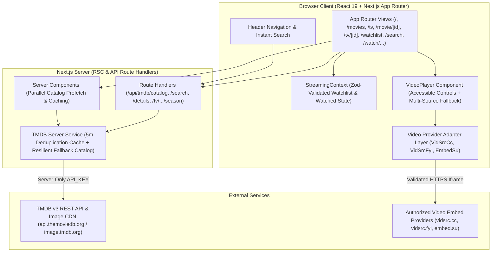

# MovieStream (KVFilmZone) — Modernized Next.js Architecture Documentation

**Project:** MovieStream Modernization  
**Application Root:** [`next-app/`](file:///Users/kingrowellvidal/Desktop/MovieStream/next-app)  
**Framework:** Next.js 15 (App Router) + TypeScript 5 (Strict Mode) + Tailwind CSS + shadcn/ui + Zod

---

## 1. High-Level System Architecture



---

## 2. Directory & Module Structure

```text
next-app/
├── e2e/
│   └── moviestream.spec.ts                # Playwright E2E regression suite (Desktop + Mobile)
├── public/                                # Original KVFilmZone icons, manifest, robots.txt
├── src/
│   ├── __tests__/                         # Vitest unit & component tests
│   │   ├── schemas-and-adapters.test.ts
│   │   ├── ui-and-navigation.test.tsx
│   │   └── video-player.test.tsx
│   ├── app/                               # Next.js App Router routes & layouts
│   │   ├── api/tmdb/                      # Server-side TMDB proxy routes (protects API key)
│   │   │   ├── catalog/route.ts
│   │   │   ├── details/[type]/[id]/route.ts
│   │   │   ├── search/route.ts
│   │   │   └── tv/[id]/season/[season]/route.ts
│   │   ├── movie/[id]/page.tsx            # Dedicated Movie Detail Page
│   │   ├── movies/page.tsx                # Dedicated Movies Catalog & Genre Filters
│   │   ├── search/page.tsx                # Dedicated Search & Media-Type Filter Page
│   │   ├── tv/[id]/page.tsx               # Dedicated TV Series & Episode Page
│   │   ├── tv/page.tsx                    # Dedicated TV Shows Catalog & Genre Filters
│   │   ├── watch/                         # Dedicated Full-Viewport Playback Routes
│   │   │   ├── movie/[id]/page.tsx
│   │   │   └── tv/[id]/[season]/[episode]/page.tsx
│   │   ├── watchlist/page.tsx             # Dedicated Watchlist ("My List") Page
│   │   ├── globals.css
│   │   ├── layout.tsx
│   │   └── page.tsx                       # Homepage Server Component
│   ├── components/
│   │   ├── browse/BrowseCatalog.tsx       # Paginated catalog grid with error recovery
│   │   ├── content/                       # Reusable cards & carousels
│   │   │   ├── ContentCard.tsx
│   │   │   ├── ContentRow.tsx
│   │   │   ├── LandscapeCard.tsx
│   │   │   └── Top10Row.tsx
│   │   ├── details/MediaDetailsView.tsx   # Full-page Movie/Series detail & episode view
│   │   ├── home/                          # Homepage hero & genre filter pills
│   │   │   ├── HeroCarousel.tsx
│   │   │   ├── HomeGenrePills.tsx
│   │   │   └── HomeView.tsx
│   │   ├── layout/                        # Responsive Header & Footer
│   │   │   ├── Footer.tsx
│   │   │   └── Header.tsx
│   │   ├── modals/                        # Quick-view Details & Player modals
│   │   │   ├── DetailsModal.tsx
│   │   │   └── GlobalModals.tsx
│   │   ├── player/                        # Accessible Video Player & Watch wrapper
│   │   │   ├── VideoPlayer.tsx
│   │   │   └── WatchPageClient.tsx
│   │   └── ui/                            # shadcn/ui primitives (Button, Badge, Card, Input, Skeleton)
│   ├── context/
│   │   └── StreamingContext.tsx           # Watchlist, Watched badges, Modals & Toast context
│   └── lib/
│       ├── ads/ad-audit.ts                # Phase 4 Advertisement classification & policy verification
│       ├── tmdb/                          # Server-only TMDB client, row configs & resilient fallback
│       │   ├── config.ts
│       │   ├── fallback-catalog.ts
│       │   └── server.ts
│       ├── video/                         # Phase 5 Isolated Video Provider Adapters
│       │   ├── adapter.ts
│       │   └── providers.ts
│       ├── schemas.ts                     # Zod runtime schemas & URL validators
│       └── utils.ts
├── next.config.mjs                        # Image remotePatterns & HTTP security headers
├── playwright.config.ts                   # Playwright Desktop Chrome & Mobile Pixel 7 config
├── tailwind.config.ts
├── tsconfig.json                          # TypeScript strict mode configuration
└── vitest.config.ts
```

---

## 3. Key Architectural Improvements Over Legacy SPA

1. **Zero Client-Side Secret Exposure:**
   - The legacy app exposed `API_KEY` in `src/constants/api.js` and `src/api/tmdb.js`.
   - In `next-app/`, `TMDB_API_KEY` is read exclusively on the server (`src/lib/tmdb/server.ts`) and never bundled into client JavaScript.
2. **Elimination of the 31-Request Client Startup Waterfall:**
   - The legacy `Home.jsx` fired 20 `/vidsrc-api/*` requests and 11 sequential TMDB requests from the browser on every page load.
   - `next-app/src/app/page.tsx` resolves all hero and row data on the server in parallel with a 5-minute deduplication cache (`revalidate: 300`).
3. **Deep-Linkable App Router URLs:**
   - Every view (`/`, `/movies`, `/tv`, `/movie/[id]`, `/tv/[id]`, `/watchlist`, `/search`, `/watch/movie/[id]`, `/watch/tv/[id]/[season]/[episode]`) has a real URL supporting browser navigation, bookmarking, and SSR metadata.
4. **Strict Zod Runtime Validation:**
   - All external URLs (`AuthorizedProviderUrlSchema`, `TmdbImageUrlSchema`), API payloads (`MediaItemSchema`, `MediaDetailsSchema`, `EpisodeSchema`), and `localStorage` entries (`WatchlistItemsStorageSchema`, `StringIdArrayStorageSchema`) are validated with Zod before use.
