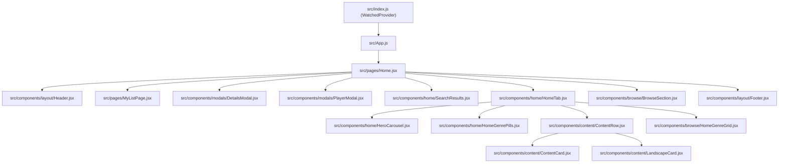

# Phase 1: Comprehensive Repository Audit Report

**Project:** MovieStream (KVFilmZone) Modernization  
**Repository:** `https://github.com/kingdinner/MovieStream`  
**Phase:** 1 — Audit (Completed prior to any application code modification)

---

## 1. Executive Summary

MovieStream (branded in-app as **KVFilmZone**) is a client-side Single-Page Application (SPA) built with **Create React App (`react-scripts` 5.0.1)** and **React 19.2.3**. It provides a Netflix-inspired movie and TV series browsing and streaming experience backed by **The Movie Database (TMDB) v3 API** for metadata and **third-party embed providers (`vidsrc.cc`, `vidsrc.fyi`, `embed.su`)** for video playback.

This audit inspected every file in the repository (`35` source/configuration files across `public/`, `src/`, and root config files) as well as the Git commit history to establish a complete, zero-guesswork baseline before migration.

---

## 2. Existing Framework & Dependencies

### 2.1 Build System & Runtime (`package.json`)
| Package | Version | Role | Audit Finding |
| :--- | :--- | :--- | :--- |
| `react` | `^19.2.3` | UI library | Active |
| `react-dom` | `^19.2.3` | DOM renderer | Active |
| `react-scripts` | `5.0.1` | Create React App bundler/dev server | Deprecated upstream; webpack 5 SPA build |
| `lucide-react` | `^0.562.0` | Icon library | Active across all UI components |
| `web-vitals` | `^5.1.0` | Performance metrics | Imported in `reportWebVitals.js` (no-op call) |
| `cra-template` | `1.3.0` | CRA scaffold artifact | Unused at runtime; leftover from initialization |
| `tailwindcss` | `^3.4.19` | Utility CSS framework (devDependency) | Configured in `index.css`, but active components primarily use inline styles + `globalStyles.js` |
| `postcss` | `^8.5.6` | CSS processor (devDependency) | Active |
| `autoprefixer` | `^10.4.23` | CSS vendor prefixing (devDependency) | Active |
| `http-proxy-middleware` | Transitive (via `react-scripts`) | Dev proxy in `src/setupProxy.js` | Implicit dependency (not listed directly in `package.json`) |

### 2.2 Configuration & Root Files
- [`package.json`](file:///Users/kingrowellvidal/Desktop/MovieStream/package.json): Defines CRA scripts (`start`, `build`, `test`, `eject`).
- [`netlify.toml`](file:///Users/kingrowellvidal/Desktop/MovieStream/netlify.toml): Configures Netlify build (`npm run build`, publish `build`), a proxy redirect from `/vidsrc-api/*` to `https://vidsrc.to/:splat` (`status = 200`), and a catch-all SPA redirect `/* -> /index.html`.
- [`tailwind.config.js`](file:///Users/kingrowellvidal/Desktop/MovieStream/tailwind.config.js) & [`postcss.config.js`](file:///Users/kingrowellvidal/Desktop/MovieStream/postcss.config.js): Standard Tailwind v3 setup scanning `./src/**/*.{js,jsx,ts,tsx}` and `./public/index.html`.
- [`.gitignore`](file:///Users/kingrowellvidal/Desktop/MovieStream/.gitignore) & [`gitignore`](file:///Users/kingrowellvidal/Desktop/MovieStream/gitignore): Duplicate files containing only `node_modules` (missing `build/`, `.env*`, coverage, and IDE ignores).

---

## 3. Complete Route & Component Mapping

### 3.1 Routing Architecture
The legacy application has **no URL router** (`react-router` is not installed). All navigation is held in ephemeral React `useState` inside [`src/pages/Home.jsx`](file:///Users/kingrowellvidal/Desktop/MovieStream/src/pages/Home.jsx):
- **Tab views (`activeTab`):** `'home'` | `'movies'` | `'tv'`
- **Search view (`searchResults.length > 0`):** Replaces tab content with `SearchResults` when `searchQuery.length >= 2`.
- **Watchlist overlay (`showMyList`):** Fixed full-screen overlay (`MyListPage`).
- **Details modal (`selected && !playing`):** Fixed modal overlay (`DetailsModal`).
- **Player modal (`selected && playing`):** Fixed full-screen overlay (`PlayerModal`).

Because there are no URL routes, users cannot bookmark or share links to specific movies, TV series, seasons/episodes, genre views, or their watchlist, and browser Back/Forward buttons exit the site instead of closing modals or navigating views.

### 3.2 Active Component Tree

### 3.3 Orphaned / Dead Files Identified
The following **12 files** exist in `src/` but are never imported by any active execution path:
1. [`src/api/tmdb.js`](file:///Users/kingrowellvidal/Desktop/MovieStream/src/api/tmdb.js) — Legacy TMDB helper module superseded by `src/constants/api.js`.
2. [`src/pages/ViewAllPage.jsx`](file:///Users/kingrowellvidal/Desktop/MovieStream/src/pages/ViewAllPage.jsx) — Superseded by `BrowseSection.jsx`.
3. [`src/components/content/Top10Row.jsx`](file:///Users/kingrowellvidal/Desktop/MovieStream/src/components/content/Top10Row.jsx) — Implemented (#1–10 ranked row) but never rendered in `HomeTab.jsx`.
4. [`src/components/content/GenrePills.jsx`](file:///Users/kingrowellvidal/Desktop/MovieStream/src/components/content/GenrePills.jsx) — Superseded by `HomeGenrePills.jsx` and inline pills in `BrowseSection.jsx`.
5. [`src/components/genre/GenreRow.jsx`](file:///Users/kingrowellvidal/Desktop/MovieStream/src/components/genre/GenreRow.jsx) — Unused legacy component.
6. [`src/components/list/EpisodeList.jsx`](file:///Users/kingrowellvidal/Desktop/MovieStream/src/components/list/EpisodeList.jsx) — Unused component linking to non-existent `/watch/tv/:id/:season/:episode` route.
7. [`src/components/list/ListItem.jsx`](file:///Users/kingrowellvidal/Desktop/MovieStream/src/components/list/ListItem.jsx) — Unused component referencing `https://via.placeholder.com/120x180`.
8. [`src/components/list/ListView.jsx`](file:///Users/kingrowellvidal/Desktop/MovieStream/src/components/list/ListView.jsx) — Empty `0`-byte file.
9. [`src/components/modal.css`](file:///Users/kingrowellvidal/Desktop/MovieStream/src/components/modal.css) — Empty `0`-byte file.
10. [`src/hooks/useTVNavigation.js`](file:///Users/kingrowellvidal/Desktop/MovieStream/src/hooks/useTVNavigation.js) — Spatial arrow-key hook, never imported.
11. [`src/App.css`](file:///Users/kingrowellvidal/Desktop/MovieStream/src/App.css) & [`src/logo.svg`](file:///Users/kingrowellvidal/Desktop/MovieStream/src/logo.svg) — Default Create React App boilerplate.
12. [`src/components/ads/AdUnit.jsx`](file:///Users/kingrowellvidal/Desktop/MovieStream/src/components/ads/AdUnit.jsx), [`src/components/ads/FloatingAd.jsx`](file:///Users/kingrowellvidal/Desktop/MovieStream/src/components/ads/FloatingAd.jsx), [`src/components/ads/InterstitialAd.jsx`](file:///Users/kingrowellvidal/Desktop/MovieStream/src/components/ads/InterstitialAd.jsx) — Unreferenced first-party ad components (detailed in Section 5).

---

## 4. Video Player & Streaming Providers Audit

### 4.1 Video Player Implementation ([`src/components/modals/PlayerModal.jsx`](file:///Users/kingrowellvidal/Desktop/MovieStream/src/components/modals/PlayerModal.jsx))
- **Architecture:** Renders a full-viewport (`position: fixed; inset: 0; z-index: 500`) container with a header bar, a sandboxed/cross-origin `<iframe>` video viewport, and a conditional TV episode navigation bar at the bottom.
- **Iframe Attributes:**
  - `allowFullScreen`
  - `allow="autoplay; fullscreen; picture-in-picture"`
  - No `sandbox` attribute is applied (allowing provider scripts inside the iframe to function without restriction, though also allowing popups if initiated by the provider).
- **Multi-Source Fallback Mechanism:**
  - Accepts `embedSources: string[]` prop from `Home.jsx`.
  - Tracks `srcIdx` (default `0`), `loaded` (`boolean`), and `loadError` (`boolean`).
  - Manual source switching via numbered buttons (`Source 1`, `2`, `3`) in the top bar (hidden on mobile screens `<= 640px` due to `.player-src-btns { display: none !important }` in `globalStyles.js` — **usability bug on mobile when Source 1 fails!**).
  - Automatic fallback via `onError={tryNext}` on the `<iframe>` element. Note: Cross-origin iframe HTTP 404/503 responses do not reliably trigger the DOM `error` event in browsers, and commit `b392ae0c` removed the 8-second timeout nudge (`nudge` state), leaving mobile users unable to switch sources if Source 1 renders an error page inside the iframe.
- **Playback Controls & Subtitles:**
  - Playback controls (play/pause, seek bar, volume, fullscreen, and subtitle track selection) are rendered natively inside the cross-origin provider `<iframe>`.
  - Default English subtitles are requested on the primary source via the `?sub=en` query parameter (`vidsrc.cc`).
  - TV episode navigation (`Prev Episode` / `Next Episode`) is provided both in the bottom bar and via global `ArrowLeft` / `ArrowRight` keydown listeners.

### 4.2 Video Source Providers ([`src/pages/Home.jsx`](file:///Users/kingrowellvidal/Desktop/MovieStream/src/pages/Home.jsx#L250-L264))
| Priority | Provider Domain | Movie Embed URL Template | TV Episode Embed URL Template | Subtitles Parameter |
| :--- | :--- | :--- | :--- | :--- |
| **1 (Primary)** | `vidsrc.cc` | `https://vidsrc.cc/v2/embed/movie/{tmdbId}?sub=en` | `https://vidsrc.cc/v2/embed/tv/{tmdbId}/{season}/{episode}?sub=en` | `?sub=en` |
| **2 (Fallback 1)** | `vidsrc.fyi` | `https://vidsrc.fyi/embed/movie/{tmdbId}` | `https://vidsrc.fyi/embed/tv/{tmdbId}/{season}/{episode}` | Provider UI |
| **3 (Fallback 2)** | `embed.su` | `https://embed.su/embed/movie/{tmdbId}` | `https://embed.su/embed/tv/{tmdbId}/{season}/{episode}` | Provider UI |

### 4.3 Stream Availability Proxy Mismatch
- On initial mount, `Home.jsx` (lines 87–108) fires **20 parallel requests** to `/vidsrc-api/movies/latest/page-{1..10}.json` and `/vidsrc-api/tvshows/latest/page-{1..10}.json` with a 6-second timeout.
- **Configuration Discrepancy Found:**
  - [`src/setupProxy.js`](file:///Users/kingrowellvidal/Desktop/MovieStream/src/setupProxy.js) proxies `/vidsrc-api` to `https://vidsrc.cc`.
  - [`netlify.toml`](file:///Users/kingrowellvidal/Desktop/MovieStream/netlify.toml) redirects `/vidsrc-api/*` to `https://vidsrc.to/:splat` (which `Home.jsx` line 249 explicitly notes is deprecated/dead).
  - If the endpoint returns non-JSON or fails, `availableIds` falls back to an empty `Set()`, in which case `filterAvailable` returns all TMDB items unfiltered.

---

## 5. Advertisements & External Scripts Audit

### 5.1 First-Party Advertisement Components (`FIRST_PARTY`)
Located in `src/components/ads/` (introduced in commit `fb1342a6`):
1. [`src/components/ads/AdUnit.jsx`](file:///Users/kingrowellvidal/Desktop/MovieStream/src/components/ads/AdUnit.jsx):
   - Renders Google AdSense `<ins className="adsbygoogle">` or a dashed "Ad Placeholder" box.
   - Pushes to `window.adsbygoogle = window.adsbygoogle || []`.
   - Imports `SHOW_ADS` and `ADSENSE_CLIENT` from `../../constants/api`, which **do not exist** in `src/constants/api.js` (broken imports).
2. [`src/components/ads/FloatingAd.jsx`](file:///Users/kingrowellvidal/Desktop/MovieStream/src/components/ads/FloatingAd.jsx):
   - Sticky `300×250` bottom-right corner overlay (`z-index: 180`) labeled `"Sponsored"` with a dismiss (`X`) button.
   - Imports undefined `SHOW_ADS` and `AD_SLOTS` from `../../constants/api`.
3. [`src/components/ads/InterstitialAd.jsx`](file:///Users/kingrowellvidal/Desktop/MovieStream/src/components/ads/InterstitialAd.jsx):
   - Full-screen pre-play modal (`z-index: 600`) with a countdown timer (`"YOUR VIDEO WILL START AFTER THIS AD"`, `"Skip in Xs"`).
   - Imports undefined `SHOW_ADS`, `AD_SLOTS`, and `INTERSTITIAL_SKIP_AFTER` from `../../constants/api`.

### 5.2 External Scripts & Third-Party Resources
1. **Google Fonts CSS (`src/styles/globalStyles.js`):**
   - `@import url('https://fonts.googleapis.com/css2?family=Bebas+Neue&family=DM+Sans:wght@300;400;500;600;700&display=swap');` injected into `<head>` at runtime.
2. **Cross-Origin Video Embed Providers (`PROVIDER_REQUIRED` / `THIRD_PARTY` / `UNKNOWN`):**
   - `https://vidsrc.cc`, `https://vidsrc.fyi`, `https://embed.su` are loaded inside `<iframe>` elements when playback starts.
   - Inside their own cross-origin browsing contexts, these providers load their player bundles (HLS.js / JWPlayer / Video.js), subtitle parsers, stream token resolvers (`PROVIDER_REQUIRED`), and provider-hosted monetization scripts (`THIRD_PARTY` / `UNKNOWN`).

---

## 6. API Calls & Network Dependencies

| Endpoint | Method | Caller | Purpose |
| :--- | :--- | :--- | :--- |
| `https://api.themoviedb.org/3/trending/all/week` | `GET` | `Home.jsx` | Hero carousel featured items (top 6 with backdrop + overview) |
| `https://api.themoviedb.org/3/trending/movie/week` | `GET` | `Home.jsx`, `BrowseSection.jsx`, `HomeGenreGrid.jsx` | Trending Movies row & browse grid |
| `https://api.themoviedb.org/3/movie/top_rated` | `GET` | `Home.jsx`, `BrowseSection.jsx`, `HomeGenreGrid.jsx` | Top Rated Movies row & browse grid |
| `https://api.themoviedb.org/3/discover/movie?with_genres={28,53,27,878,35}` | `GET` | `Home.jsx`, `BrowseSection.jsx`, `HomeGenreGrid.jsx` | Action, Thriller, Horror, Sci-Fi, Comedy rows & grids |
| `https://api.themoviedb.org/3/trending/tv/week` | `GET` | `Home.jsx`, `BrowseSection.jsx`, `HomeGenreGrid.jsx` | Trending TV Shows row & browse grid |
| `https://api.themoviedb.org/3/tv/top_rated` | `GET` | `Home.jsx`, `BrowseSection.jsx`, `HomeGenreGrid.jsx` | Top Rated Series row & browse grid |
| `https://api.themoviedb.org/3/discover/tv?with_genres=16&with_original_language=ja&sort_by=first_air_date.desc` | `GET` | `Home.jsx`, `BrowseSection.jsx`, `HomeGenreGrid.jsx` | Latest Anime row & browse grid |
| `https://api.themoviedb.org/3/tv/{id}` | `GET` | `Home.jsx` | Fetch TV show seasons list when a TV item is selected |
| `https://api.themoviedb.org/3/tv/{id}/season/{season}` | `GET` | `Home.jsx` | Fetch episodes for selected TV season |
| `https://api.themoviedb.org/3/{movie\|tv}/{id}/recommendations` | `GET` | `DetailsModal.jsx` | "More Like This" recommendations strip |
| `https://api.themoviedb.org/3/search/multi?query={q}` | `GET` | `Home.jsx` | Debounced (350ms) multi-search filtered to `movie` and `tv` |
| `https://image.tmdb.org/t/p/{size}{path}` | `GET` | `HeroCarousel`, `ContentCard`, `LandscapeCard`, `DetailsModal` | Poster and backdrop images (`original`, `w1280`, `w780`, `w500`, `w342`, `w300`) |
| `/vidsrc-api/{movies\|tvshows}/latest/page-{1..10}.json` | `GET` | `Home.jsx` | Proxied VidSrc streamable ID lookup (20 requests on mount) |

---

## 7. Security, Performance & Reliability Risks

### 7.1 Security Risks
1. **Exposed API Key in Source Code & Browser Network Traffic (Critical):**
   - `API_KEY = 'b8d6458a6244de711c4934b1896ac164'` is hardcoded in plain text in both `src/constants/api.js` and `src/api/tmdb.js`, committed to Git, and sent directly from the client browser in every TMDB request URL.
   - **Remediation in Next.js Migration:** Move `TMDB_API_KEY` to server-side environment variables and proxy all TMDB requests through Next.js Server Components and Route Handlers (`/api/tmdb/...`) so the secret is never exposed to the client bundle or browser network tab.
2. **Unvalidated External URLs & Data Payloads (High):**
   - TMDB API responses and video provider URLs are consumed without runtime schema validation.
   - **Remediation in Next.js Migration:** Validate all API parameters, TMDB responses, localStorage state, and video provider embed URLs (strictly allowlisting authorized HTTPS provider origins and validating TMDB numeric IDs/season/episode bounds) using **Zod**.
3. **Unsafe `localStorage` Deserialization (Medium):**
   - `Home.jsx` and `WatchedContext.js` call `JSON.parse(localStorage.getItem(...))` directly inside `useState` initializers without `try/catch` or schema validation. Corrupted storage crashes the entire React tree on boot.
4. **Missing Security Headers (Medium):**
   - Neither `public/index.html` nor `netlify.toml` sets `X-Content-Type-Options`, `Referrer-Policy`, `X-Frame-Options`, or `Permissions-Policy`.

### 7.2 Performance & Reliability Risks
1. **31 Client-Side Waterfall Requests on Initial Load:**
   - Mounting `Home.jsx` triggers 20 requests to `/vidsrc-api/*` plus 11 requests to TMDB (`1` trending + `10` rows in batches of 2 with artificial 120ms delays).
   - **Remediation:** Server-side data fetching with Next.js caching (`revalidate`) and parallel server-side aggregation eliminates client-side waterfalls and redundant API requests.
2. **Unoptimized `original` Resolution Hero Images:**
   - `HeroCarousel.jsx` loads all 6 slides using `https://image.tmdb.org/t/p/original/...` (often 4K+ 5–10MB JPEGs) simultaneously in the DOM.
3. **Mobile Source Selector Hidden by CSS (`globalStyles.js` line 274):**
   - `.player-src-btns { display: none !important; }` on `@media (max-width: 640px)` prevents mobile users from switching video sources when a provider fails.
4. **Broken Test Suite:**
   - `src/App.test.js` still tests for CRA's boilerplate `learn react` link, which does not exist in `KVFilmZone`.
