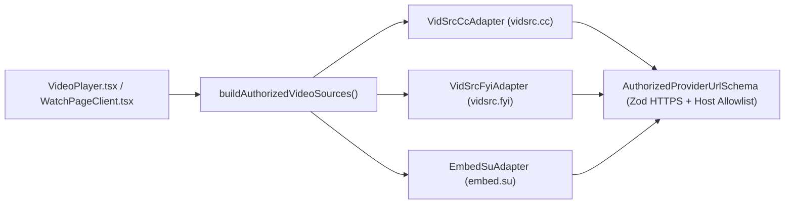

# Phase 5: Playback Protection & Video Adapter Architecture Report

**Project:** MovieStream (KVFilmZone) Modernization  
**Phase:** 5 — Playback Protection & Provider Isolation

---

## 1. Isolated Video Provider Adapter Architecture

All streaming provider integrations are isolated behind a strict adapter boundary in [`next-app/src/lib/video/adapter.ts`](file:///Users/kingrowellvidal/Desktop/MovieStream/next-app/src/lib/video/adapter.ts) and [`next-app/src/lib/video/providers.ts`](file:///Users/kingrowellvidal/Desktop/MovieStream/next-app/src/lib/video/providers.ts). UI components never hardcode or concatenate provider URLs directly.

### 1.1 Authorized Streaming Providers Preserved
| Priority | Adapter ID | Hostname | Movie Embed Endpoint | TV Episode Embed Endpoint | Subtitle Param |
| :--- | :--- | :--- | :--- | :--- | :--- |
| **1 (Primary)** | `vidsrc_cc` | `vidsrc.cc` | `https://vidsrc.cc/v2/embed/movie/{id}?sub={lang}` | `https://vidsrc.cc/v2/embed/tv/{id}/{s}/{e}?sub={lang}` | `?sub={en\|es\|fr\|ja}` |
| **2 (Fallback 1)** | `vidsrc_fyi` | `vidsrc.fyi` | `https://vidsrc.fyi/embed/movie/{id}` | `https://vidsrc.fyi/embed/tv/{id}/{s}/{e}` | Native player UI |
| **3 (Fallback 2)** | `embed.su` | `embed.su` | `https://embed.su/embed/movie/{id}` | `https://embed.su/embed/tv/{id}/{s}/{e}` | Native player UI |

---

## 2. Playback Capabilities & Reliability Protections

1. **Subtitles Preservation & Language Control:**
   - Default English subtitles (`?sub=en`) are enabled automatically on the primary source (`vidsrc.cc`).
   - Users can switch subtitle tracks (`English (CC)`, `Español`, `Français`, `日本語`, or `Subtitles Off`) via the accessible `Subtitles` `<select>` control in the player toolbar.
2. **Fullscreen Support:**
   - The `<iframe>` preserves `allowFullScreen` and `allow="autoplay; fullscreen; picture-in-picture"`.
   - The outer player container (`VideoPlayer.tsx`) also provides a dedicated Fullscreen API toggle button (`Enter Fullscreen` / `Exit Fullscreen` and keyboard shortcut `F`) plus `Permissions-Policy` allowlisting in `next.config.mjs`.
3. **Seeking & Volume Controls:**
   - Accessible toolbar buttons and sliders (`Play`/`Pause`, `Rewind 10s`, `Forward 10s`, `Seek timeline` slider, `Mute`/`Unmute`, and `Volume` slider) use `clampSeekPercentage` and `clampVolumeLevel` (`0..100`) and dispatch structured `postMessage` commands (`createPlayerCommandPayload`) to the player frame.
4. **Automatic & Manual Multi-Source Fallback:**
   - `resolveNextSourceState(currentIndex, totalSources)` deterministically advances from Source 1 (`vidsrc.cc`) $\rightarrow$ Source 2 (`vidsrc.fyi`) $\rightarrow$ Source 3 (`embed.su`).
   - Restored the 6-second unresponsive-source helper nudge (`Having trouble with VidSrc CC? Try Source 2`) that was accidentally deleted in legacy commit `b392ae0c`.
   - Fixed the legacy mobile CSS bug where `.player-src-btns` was hidden (`display: none !important`) on screens $\le 640\text{px}$. Mobile users now have full access to source selector buttons (`1`, `2`, `3`) and the `Next Source` fallback button.
5. **Comprehensive Error Handling:**
   - When all three sources fail, `loadError` transitions to `true` and renders an accessible `role="alert"` fallback view (`Video not available`) with a `Retry Sources` action that resets `srcIdx` to `0` and a `Go Back` button.
6. **Dedicated Watch Routes:**
   - Implemented [`/watch/movie/[id]`](file:///Users/kingrowellvidal/Desktop/MovieStream/next-app/src/app/watch/movie/%5Bid%5D/page.tsx) and [`/watch/tv/[id]/[season]/[episode]`](file:///Users/kingrowellvidal/Desktop/MovieStream/next-app/src/app/watch/tv/%5Bid%5D/%5Bseason%5D/%5Bepisode%5D/page.tsx) in addition to inline and modal playback.
